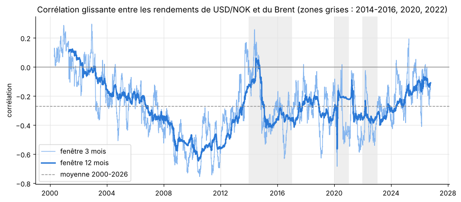
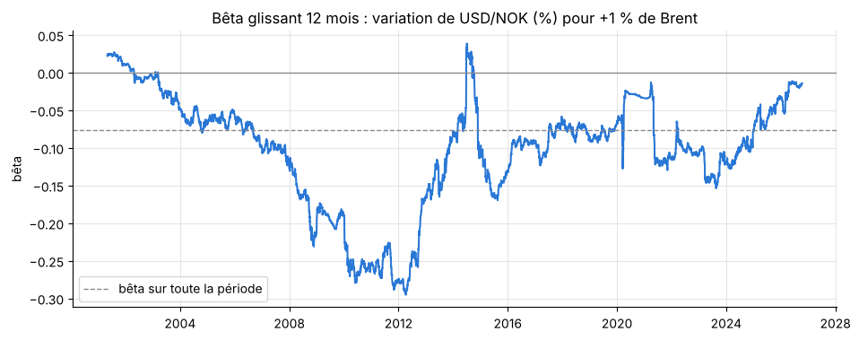
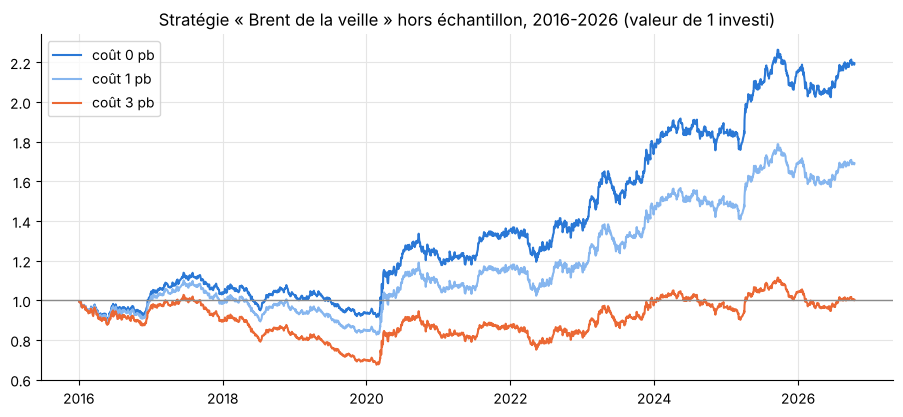

# Petrocurrency Model : la couronne norvégienne (NOK) et le Brent

Analyse en Python du lien entre la couronne norvégienne et le prix du pétrole (Brent), de 2000 à 2026 : corrélations, décalages, causalité de Granger, régression, comparaison avec les travaux de la Norges Bank, lecture des fondamentaux du pétrole et backtest d'une stratégie simple.

**Auteur :** Kader, MSc Financial Markets, Trading & Risk Management (INSEEC)

## Lire le projet

| Format | Fichier |
|---|---|
| Notebook exécuté (code, graphiques, commentaires) | [`petromonnaie_NOK_Brent.ipynb`](petromonnaie_NOK_Brent.ipynb) |
| Version PDF | [`petromonnaie_NOK_Brent.pdf`](petromonnaie_NOK_Brent.pdf) |
| Version HTML (à télécharger puis ouvrir dans un navigateur) | [`petromonnaie_NOK_Brent.html`](petromonnaie_NOK_Brent.html) |

## Données

Séries journalières publiques téléchargées sur [FRED](https://fred.stlouisfed.org/) (Federal Reserve Bank of St. Louis), dans le dossier [`data/`](data) :

- `DEXNOUS.csv` : USD/NOK, nombre de couronnes pour 1 dollar (cours de midi à New York), du 03/01/2000 au 16/10/2026.
- `DCOILBRENTEU.csv` : Brent spot en dollars par baril (source EIA), du 04/01/2000 au 14/10/2026.

Aucune valeur n'est interpolée : seuls les 6 326 jours cotés sur les deux séries sont conservés.

## Méthode

1. **Préparation :** contrôle qualité, alignement des calendriers, rendements logarithmiques, test de stationnarité (ADF).
2. **Corrélation :** globale (journalière, hebdomadaire, mensuelle ; Pearson et Spearman), glissante sur 3 et 12 mois, par période (2014-2016, 2020, 2022...).
3. **Décalage et causalité :** corrélations croisées, test de Granger dans les deux sens, régression avec erreurs-types robustes (Newey-West), bêta glissant.
4. **Comparaison avec la Norges Bank :** réplication simplifiée de ses estimations (Staff Memos 18/2016, 16/2016, 7/2017 ; Monetary Policy Reports 1/2023 et 4/2025).
5. **Fondamentaux du pétrole :** contango, backwardation, stocks et OPEP+, à partir de publications de l'EIA (analyse qualitative, sans données de futures).
6. **Backtest :** position sur USD/NOK selon le Brent de la veille, apprentissage 2000-2015, test hors échantillon 2016-2026, coûts de transaction de 0 à 3 points de base.

## Principaux résultats

- **La NOK est une pétromonnaie** : corrélation négative entre USD/NOK et le Brent (-0,27 en journalier, -0,39 en mensuel). Une hausse de 10 % du Brent s'accompagne d'une baisse d'environ 0,76 % de USD/NOK le même jour.
- **La relation est instable** : quasi absente en 2000-2003, très forte en 2008-2012 (bêta ≈ -0,25), plus faible depuis, et presque nulle pendant le choc pétrolier de 2026.
- **L'effet est contemporain** : presque toute la relation passe le jour même ; l'effet du Brent de la veille est faible et n'apparaît qu'après 2016.
- **Cohérence avec la Norges Bank** : même signe, même instabilité, même hausse de la sensibilité jusqu'en 2015 ; nos coefficients sont plus élevés car USD/NOK inclut un effet dollar.
- **La stratégie n'est pas exploitable de façon fiable** : Sharpe de 0,65 avant coûts hors échantillon, mais gain annulé vers 3 points de base de coût, et aucun signal sur la période d'apprentissage.







## Reproduire l'analyse

```bash
pip install -r requirements.txt
jupyter notebook petromonnaie_NOK_Brent.ipynb
```

## Sources

- ter Ellen, S. (2016), *Nonlinearities in the relationship between oil price changes and movements in the Norwegian krone*, Norges Bank Staff Memo 18/2016. [PDF](https://www.norges-bank.no/contentassets/0e24aab656ef4e3e987eb0044b324565/staff-memo-18_2016_eng.pdf)
- ter Ellen, S. et Martinsen, K. (2016), *Oil price shocks and the Norwegian effective exchange rate – an SVAR approach*, Norges Bank Staff Memo 16/2016. [PDF](https://www.norges-bank.no/contentassets/d0d21c7e8c8c4ae5b619569a435a8c63/staff-memo-16_2016.pdf)
- Martinsen, K. (2017), *Norges Bank's BEER models for the Norwegian effective exchange rate*, Norges Bank Staff Memo 7/2017. [PDF](https://www.norges-bank.no/contentassets/d98b46b49ba44702b30773772c040f08/staff_memo_7_2017.pdf)
- Norges Bank, [Monetary Policy Report 1/2023](https://www.norges-bank.no/en/news-events/publications/Monetary-Policy-Report/2023/mpr-12023/web-report-mpr-12023/) et [Monetary Policy Report 4/2025](https://www.norges-bank.no/en/news-events/publications/Monetary-Policy-Report/2025/mpr-42025/web-report-mpr-42025/).
- EIA, [What drives crude oil prices: Balance](https://www.eia.gov/finance/markets/crudeoil/balance.php), et articles *Today in Energy* cités dans le notebook.

## Limites

USD/NOK plutôt qu'un indice effectif (effet dollar) ; pas de contrôle de l'écart de taux d'intérêt ; pas de données de futures CO1-CO12 ; horaires de cotation légèrement différents entre les deux séries ; coûts de transaction supposés.
